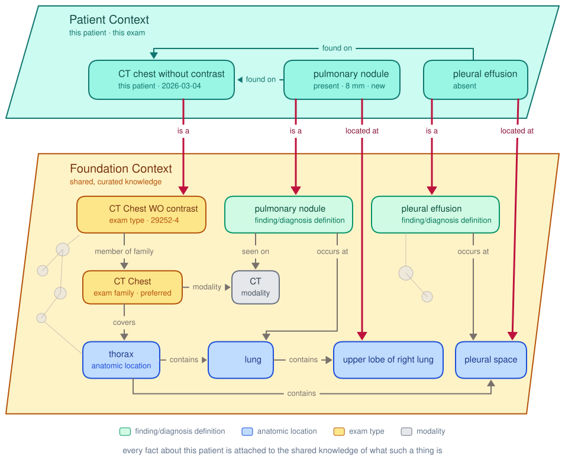

# Open Imaging Data Model

The Open Imaging Data Model (OIDM) is an effort to model the context of imaging work across its whole lifecycle, from ordering through acquisition, interpretation, reporting, and follow-up, so that the medical imaging ecosystem has a common platform on which to build tools that assist radiologists, technologists, ordering providers, and back-office staff.[^lead-2026-09-24]

The current focus is one part of that: data structures and semantics for representing imaging results. That means results from the current exam and from prior exams, produced by radiologists, technologists, AI, or the modalities themselves, and integrated across time so that a finding has a history rather than a series of disconnected mentions. Later work will model the broader patient context, integrating imaging results into the larger fabric of the patient's history and linking them to the patient's other diagnoses, procedures, and issues.[^lead-2026-09-24]

OIDM defines data structures for use inside applications, to both read and create data. It is not a transport format. FHIR and DICOM expressions of the structures are designed separately and are guided by them.[^lead-2026-09-19]

# Why results as data

Today the findings in a radiology report are written for a human reader and then locked in narrative text. Represented as data, once, each finding becomes reusable in two directions: forward to clinicians, to drive treatment decisions, follow-up, and care coordination; and forward to the next radiologist reading the subsequent exam, who needs to know what was there before, where, and whether it changed.[^siim-2026]

# The two contexts

A structured finding, say "pulmonary nodule, present, right upper lobe, 8 mm, new", says what exists, where, and on what exam. It does not say how a nodule associates with other findings, how it might be precancerous, which prior exams could show it, what the implications are, or what else it could be. That knowledge is not in the patient's record. It is background knowledge of anatomy, pathology, and imaging technique.[^siim-2026]

OIDM therefore separates two things. **Patient Context** is this patient's results and clinical context: one per patient, protected health information, changing as the patient's condition evolves. **Foundation Context** is a single shared layer of definitions, relationships, and citations: what a pulmonary nodule is, where it can occur, what it can cause, what it can be confused with. It is open, not patient-specific, authored and versioned in the open.[^siim-2026] The two are deeply interconnected: every contingent fact about this patient, this nodule on this exam, is attached to the baseline clinical knowledge about what such a thing is, so that an application reading the patient's record has the knowledge to interpret it.[^lead-2026-09-24]

(click the image for full size)

# The core pieces

**[Foundation Context](./foundation-context/index.md).** The shared semantic layer. It has three axes, each a curated layer over an existing standard: what was found (finding/diagnosis definitions, held as Open Imaging Finding Models and as ACR/RSNA Common Data Elements), where it is (anatomic locations anchored in RadLex), and how it was seen (exam types over the LOINC/RSNA Radiology Playbook). The axes relate to each other and cite external references. This pillar covers both the shape a definition takes and the work of building the content.[^siim-2026][^build-plan]

**[Data Structures](./data-structures/index.md).** The patient-side structures. The Observation is the atomic unit: one finding or diagnosis, its presence, its change from prior, its location, its characterizing attributes, and its ties into Foundation Context. Observations can come from a radiologist, a technologist, an AI, or the modality itself. An Exam Finding List holds all the Observations from one exam. An Imaging Problem List reorganizes a patient's Observations by finding, across exams, so that each finding has a history. The Imaging Persona is the proposal that goes furthest: the imaging results integrated into a single larger graph of the patient's history, with the patient's other diagnoses, procedures, and issues, the whole of it underpinned by Foundation Context. Patient-side data forms one graph and Foundation Context forms another, and the patient graph is woven into the foundation graph at every finding, diagnosis, location, and exam type.[^siim-2026][^lead-2026-09-24]

**[SDKs](./sdks/index.md).** The tools that wrap these structures so that developers can create, read, and manipulate instances in real applications, and that attach the shared knowledge to a patient's data the same way every time. Some SDK capabilities also support the authoring of Foundation Context itself.[^build-plan][^siim-2026]

# Use cases

With structured results and shared context, the same machinery serves many purposes: reporting assistance that knows what a finding is; longitudinal tracking of findings across exams; decision support, follow-up management, and care coordination; quality surveillance; registry submission and research extraction; and grounding for generative tools, which get a citable shared context instead of inventing one.[^webinar-2026-07][^siim-2026][^use-cases-index] The [Use Cases](./use-cases/index.md) section lists every purpose the project has written down, with a page for each one worked out in detail.

# Sample applications

The project has built demonstrations to make the ideas concrete. Each is listed in [Sample Applications](./sample-applications/index.md) with the idea it illustrates.

- [Finding Model Forge](https://fmf.oidm.org), for authoring and reviewing finding/diagnosis definitions.[^forge-docs]
- The [finding models catalog](https://openimagingdata.github.io/finding-models-site/), for browsing the definitions.[^catalog-site]
- Command-line tools for finding models and for anatomic locations.[^fm-cli]
- Two Imaging Problem List viewers: [the first](https://imaging-problem-list.pages.dev), and [the second](https://main.ipl-anatomy.pages.dev), organized by anatomy.[^webinar-2026-07][^ipl-readme]
- A report extraction and coding platform that turns report text into Observations.[^ipl-readme]
- Public demonstrations of rendering a coded finding as prose (2023), ontology search (2024), and assisted reporting (2024).[^site-2023-06][^site-2024-07][^site-2024-01]

# Where things stand

Nothing here is formally specified. The project is coalescing, and its structures exist in several dated versions: in code, in manuscripts under review, in talks, and in working documents. This knowledgebase presents each version beside the others, attributed and dated, and states disagreements without resolving them.[^build-plan]

The project asks three things: contribute or propose finding/diagnosis definitions; review AI-generated content and connections; build against the SDKs.[^siim-2026]

[^lead-2026-09-24]: The project lead, 2026-09-24, on the scope of OIDM, the Imaging Persona, and the interconnection of the two graphs; recorded verbatim in the layout plan.
[^lead-2026-09-19]: The project lead, 2026-09-19, notes on the revised Imaging Problem List manuscript: data structures for use within applications, not a transport definition.
[^siim-2026]: SIIM 2026 annual meeting talk, June 2026, Mass General Brigham; slides 3, 4, 5, 6, 7, 8, 14, and 15.
[^status-2026-01]: Open Imaging Data Model 2026 Status Update, January 2026.
[^webinar-2026-07]: SIIM Enterprise Imaging webinar, 15 July 2026, the six application families and the two live-prototype slides.
[^use-cases-index]: Use case catalog index, UseCases repository, commit 71a90d2: "Add information to ACR GRID registry".
[^forge-docs]: Finding Model Forge, finding model creation workflow document, dev branch.
[^catalog-site]: finding-models-site repository.
[^fm-cli]: findingmodel README, main branch, command-line tools.
[^ipl-readme]: imaging-problem-list README, dev branch.
[^site-2023-06]: "SIIM update", openimagingdata.org, June 2023.
[^site-2024-01]: "2024 New Year Update", openimagingdata.org, January 2024.
[^site-2024-07]: "SIIM 2024 update, hackathon edition", openimagingdata.org, July 2024.
[^build-plan]: Knowledgebase build plan, the project lead's stated goals (2026-09-20) and "No specification exists" (2026-09-21).
